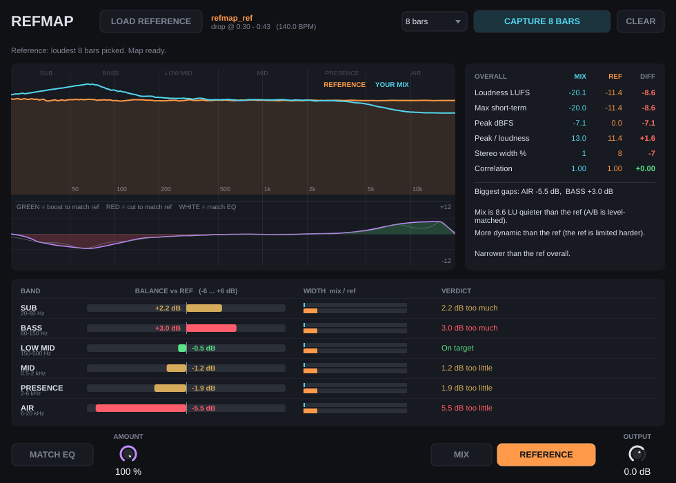

# Refmap — reference track vs your loop

Load a reference track and capture 4, 8 or 16 bars of your mix. Refmap compares the two band by band, tells you what to change, and can apply a match EQ that pulls your mix toward the reference.
VST3 / AU / Standalone, macOS + Windows, JUCE 8.



## Use it in Ableton
1. Put Refmap on the **master** (or a group/bus you want to check). Put it **before** your limiter if you want the match EQ to feed the limiter.
2. **Load reference**: click it, or drag a WAV, AIFF, FLAC, MP3 or OGG onto the plugin. Refmap scans the whole track and picks its **loudest N-bar section (the drop)** at your project tempo.
3. Choose the loop length (4, 8 or 16 bars), click **Capture**, then press play. Recording starts at the next bar line and stops after N bars. If you stop the transport mid-capture, it restarts on the next play.
4. Read the map.

## What you see
- **Spectrum**: reference (orange) vs your mix (cyan), level-normalised so you compare tone, not volume. Tilted +3 dB/oct so a balanced mix reads roughly flat. Hover for exact numbers.
- **Difference**: green = what your mix is missing, red = what it has too much of. White = the match EQ curve.
- **Overall**: LUFS, max short-term, peak, peak-to-loudness (how hard it's limited), stereo width, correlation, plus plain-language notes.
- **Band map**: Sub / Bass / Low Mid / Mid / Presence / Air. Shows balance vs the reference, width (mix vs ref), and a verdict for each band, e.g. "3.0 dB too much", "sub not mono" or "narrower than ref".

## Controls
| Control | What it does |
|---|---|
| **Match EQ + Amount** | 10-band minimum-phase EQ fitted to the gap (max ±9 dB per band). Start at 30–50 %. |
| **Mix / Reference** | A/B. Plays the reference drop **level-matched to your loop**, so you're not fooled by loudness. Synced to your transport. |
| **Clear** | Forget the captured loop |
| **Output** | Output gain |

Zero latency. With Match EQ off and Listen on Mix, the audio passes through untouched.
The captured analysis, reference path and match EQ are saved with your Live set. The reference audio reloads from disk.

## Build: GitHub Actions
1. Push this folder to a GitHub repo, including the hidden `.github` folder.
2. Actions tab → latest run → Artifacts: Mac VST3 + AU, Windows VST3.
3. Install:
   - **Mac:** `Refmap.vst3` → `~/Library/Audio/Plug-Ins/VST3/`, `Refmap.component` → `~/Library/Audio/Plug-Ins/Components/`, then
     `xattr -cr ~/Library/Audio/Plug-Ins/VST3/Refmap.vst3 ~/Library/Audio/Plug-Ins/Components/Refmap.component` (unsigned build)
   - **Windows:** `Refmap.vst3` → `C:\Program Files\Common Files\VST3\`
4. Ableton → Settings → Plug-Ins → Rescan.

## Build locally
```bash
cmake -B build -G Xcode                      # Mac (universal)
cmake -B build -G "Visual Studio 17 2022"    # Windows
cmake --build build --config Release
```
Offline test (synthetic reference and mix, drives the real processor): `cmake -B build -DREFMAP_TESTS=ON && cmake --build build --target RefmapTest`

## Source map
- `Source/Analysis.h`: K-weighted loudness (BS.1770 gating), FFT spectra, band balance and width, drop finder, match-EQ fit
- `Source/PluginProcessor.*`: bar-synced capture, background analysis, match EQ, level-matched A/B, state
- `Source/PluginEditor.*`, `Source/RefmapLookAndFeel.h`: UI
- `tests/RefmapTest.cpp`: offline test harness
